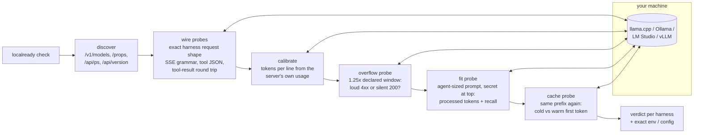

# localready

**Your local model server says `200 OK`. Your coding agent still breaks. `localready` tells you why in one command, and prints the fix.**

[](https://github.com/Prime-agentai/localready/actions/workflows/ci.yml)


[](LICENSE)

Pointing Claude Code, Codex or OpenCode at llama.cpp, Ollama, LM Studio or vLLM fails in ways
that look like a dumb model but are really configuration:

- the context window is smaller than the agent's *first* request;
- the server silently cuts the top of the prompt, so the agent loses its system prompt and tools;
- the agent never compacts because it thinks your 16k model has a 1M window;
- `max_tokens: 32000` plus the prompt is over the server's budget;
- tool calls stream as JSON that does not parse;
- every turn re-processes the whole conversation.

`localready check` probes the **exact request shape the agent sends**, measures the window with the
server's own token counts, times an **agent-sized** prefill, checks the prefix cache, and prints a
verdict plus the setup that fixes it. Zero dependencies.

```bash
uvx --from git+https://github.com/Prime-agentai/localready localready check
```

## 30-second quickstart

```bash
# 1. Probe whatever is running on the usual ports (Ollama 11434, llama.cpp 8080, LM Studio 1234, vLLM 8000)
uvx --from git+https://github.com/Prime-agentai/localready localready check

# 2. Apply the client setup it prints (exit code 0 = ready, 2 = not ready)
eval "$(uvx --from git+https://github.com/Prime-agentai/localready localready env)"
claude
```

Or `pip install git+https://github.com/Prime-agentai/localready`, then `localready check http://127.0.0.1:8080 -H all`.

## A real run

llama.cpp b12680, Qwen3-0.6B Q8_0, `-c 16384 --reasoning off`, on a 6-core CPU box with no GPU.
This is the unedited output except for the elided setup lines
([full log and method](docs/live-llamacpp.md)):

```text
localready  http://127.0.0.1:18080  model models/qwen3-0.6b-q8.gguf
engine: llama.cpp b12680-12d47ba2f, window 16,384 (/v1/models meta.n_ctx)

Anthropic Messages wire
  PASS  Anthropic Messages endpoint (/v1/messages)
  PASS  Claude Code request shape (2.1.330 fields)
        accepted all 8 fields Claude Code sends
  PASS  Claude Code's max_tokens 32000 fits the window
  PASS  Streaming tool call (SSE grammar + input_json_delta)
        13 events, tool_use lookup_ticket({"ticket_id": 42})
  PASS  Tool result reaches the model (tool_use -> tool_result)
  PASS  Token counting (/v1/messages/count_tokens)

Context and speed (measured through Anthropic Messages wire)
  PASS  Over-long prompt is refused, not silently cut
        ~20736 tokens refused in 0.55s: request (21272 tokens) exceeds the available context size (16384 tokens)
  PASS  Claude Code's first request fits (11,876 tokens)
        processed 12131 tokens; model recalled the code from the top
  PASS  Prompt prefix is reused between turns
        first-token time 329.56s cold -> 12.52s with the same prefix, server reports 12,105 cached tokens
  FAIL  Prefill speed
        36 tokens/s (client timing): Claude Code's first request takes ~330s before the first token
        fix: use a smaller model or a GPU/Metal build; prefill, not generation, dominates agent latency
  WARN  Generation speed
        1.4 tokens/s (client timing)
  WARN  Context window for agent work
        16,384 tokens, below the 65,536 recommended for coding agents; roughly 2 tool turns of headroom
        after the first request. Tell the harness the real window so it compacts before the server refuses.

Verdict
  FAIL  Claude Code: NOT READY

# Claude Code setup for this server
export ANTHROPIC_BASE_URL=http://127.0.0.1:18080
export ANTHROPIC_MODEL=models/qwen3-0.6b-q8.gguf
export ANTHROPIC_DEFAULT_HAIKU_MODEL=models/qwen3-0.6b-q8.gguf   # background tasks must hit the local model too
export CLAUDE_CODE_MAX_CONTEXT_TOKENS=16384   # Claude Code assumes 1M for unknown ids and would not compact
export CLAUDE_CODE_MAX_OUTPUT_TOKENS=4096     # Claude Code asks for 32000 per request
...
```

The wire is perfect and the cache works, so this box is **not ready** for one reason only:
Claude Code's first request is a 5.5-minute prefill here. That is the honest answer, and it is
the reason most "local Claude Code is unusable" threads exist.

## What it checks

| Symptom you see | Real cause | Probe | Fix it prints |
|---|---|---|---|
| `Prompt is too long` on the first message | window < the agent's first request (Claude Code 2.1.330: **11,876 tokens**, measured) | `context.fit` | `-c 65536` / `OLLAMA_CONTEXT_LENGTH=65536` / `lms load --context-length` / `--max-model-len` |
| Agent ignores instructions, forgets its tools | server answers 200 but **silently drops** the top of an over-long prompt | `context.overflow`, `context.fit` (server token counts, not guesses) | the engine's window setting |
| Works for a few turns, then every request fails | Claude Code assumes **1M** for unknown model ids and never compacts ([docs](https://code.claude.com/docs/en/model-config)) | `context.window` | `CLAUDE_CODE_MAX_CONTEXT_TOKENS=<measured>` |
| Every request rejected on vLLM-style servers | prompt + `max_tokens 32000` > window | `anthropic.output_budget` | `CLAUDE_CODE_MAX_OUTPUT_TOKENS` |
| 400 on a field you never set | server rejects part of Claude Code's real request (`thinking: adaptive`, `context_management`, a `role:"system"` message, `cache_control`...) | `anthropic.claude_code_shape` names the field | per field |
| Tools never run, or run with garbage | broken SSE grammar or tool-argument deltas that do not assemble into JSON | `*.stream_tool` | the engine's tool parser / template flag |
| Tool output ignored | the model, not the server (the wire carried it) | `*.roundtrip` (WARN, not FAIL) | choose another model |
| Minutes per turn | agent-sized prefill speed; prefix cache missing | `speed.prefill`, `speed.cache` | numbers, not adjectives |

Model faults are **WARN** and wire faults are **FAIL**, because the fixes are completely different.

## What Claude Code actually sends (measured)

Captured with `localready proxy` from Claude Code 2.1.330 in an empty project, `claude -p`, no MCP servers:

| | |
|---|---|
| First request | **11,876 prompt tokens** (Qwen3 tokenizer, llama.cpp usage) |
| Tools | 12 built-in tools, 31.5 KB of JSON schema |
| System | 3 text blocks, two with `cache_control`, plus the environment as a `role:"system"` **message** |
| Extras | `thinking: {type: adaptive}`, `context_management`, `output_config.effort`, `metadata` |
| `max_tokens` | 32,000 (`CLAUDE_CODE_MAX_OUTPUT_TOKENS=4096` changes it to 4,096: measured) |
| Prefix between turns | **99%** reusable from turn 1 to turn 2 (the system message switches from blocks to a string with the same text, which renders identically) |
| `CLAUDE_CODE_ATTRIBUTION_HEADER=0` | removes the first system block (a version header): measured |
| Unknown model id | `Claude Code doesn't recognize the model ... assumes a context window of 1m tokens`; gone with `CLAUDE_CODE_MAX_CONTEXT_TOKENS` (verified live) |

Your numbers differ with your tools, MCP servers and `CLAUDE.md`. Measure them with the proxy.

## How it works



- **Acceptance probes hang up early.** Checking that the server accepts `max_tokens: 32000` would
  otherwise make a CPU box generate for an hour; `localready` streams and disconnects after the
  first event, and the server cancels (llama.cpp logs `cancel task`).
- **Token-accurate, tokenizer-agnostic.** Two small calibration calls give tokens per line for
  *your* model's tokenizer, so the fit probe sends the size the agent really sends.
- **Truncation is judged by the server's own counts**, recall is a second signal. A server that
  reports no usage gets a WARN, never a false PASS.

## Commands

```text
localready check [URL] [-m MODEL] [-H claude-code|codex|openai-chat|all] [--quick] [--need N] [--json]
localready env   [URL] [-m MODEL] [-H ...]          # export lines / config only (quick probes)
localready proxy [UPSTREAM] [--listen 127.0.0.1:8787] [--log calls.jsonl] [--save-bodies DIR]
localready scan                                      # find servers on the usual local ports
```

Exit codes: `0` ready (warnings allowed), `2` not ready, `1` usage error. `--quick` runs the wire
probes only (seconds); the full check pays for one real agent-sized prefill.

### `localready proxy`: watch a real session

Put it between the agent and the server. Each model call prints one line: prompt tokens and how
many the server served from cache, time to first byte, how much of the prompt an ideal prefix
cache could reuse from the previous call, and, when that drops, **which segment changed and how**:

A real Claude Code 2.1.330 session against the 16k llama.cpp server above:

```text
#1   /v1/messages 200  in 11867 (cache 1)  out 21  ttfb 33.40s total 330.68s
#2   /v1/messages 200  in 13214 (cache 11863)  out 291  ttfb 30.13s total 264.40s  prefix reuse 88%
#3   /v1/messages 200  in 12388 (cache 9356)  out 70  ttfb 30.20s total 197.54s  prefix reuse 74%
      prefix broke in messages[0:user]: ...me":"Write"}<system-reminder>\n[Attribution for git commits an -> Called the Read tool with the ]
```

Call 2 reuses the whole of call 1. In call 3 the history was rewritten (consistent with Claude
Code compacting at the 16k window it was given), and only the system prompt and tools stayed
cached. When something near the top of the prompt changes between calls, for example a build
number in the system prompt, the proxy names it:

```text
#1   /v1/messages 200  in 1960 (cache 0)  out 1  ttfb 0.01s total 0.01s
#2   /v1/messages 200  in 1963 (cache 1959)  out 1  ttfb 0.01s total 0.01s  prefix reuse 100%
#3   /v1/messages 200  in 1963 (cache 1)  out 1  ttfb 0.00s total 0.00s  prefix reuse 0%
      prefix broke in system[0]: ...build: [1;Agent rules. Agent rules. Ag -> 2;Agent rules. Agent rules. Ag]
```

Authorization headers are never logged; bodies only with `--save-bodies`.

## Engines and harnesses

| | Measured live in this repo | Covered by fake-engine tests |
|---|---|---|
| llama.cpp `llama-server` | yes (b12680) | yes |
| Ollama | no | discovery, loaded window, silent truncation, fix |
| LM Studio | no | discovery, loaded window |
| vLLM | no | discovery, `max_model_len`, output-budget rejection |
| Claude Code | yes (2.1.330) | Anthropic Messages wire |
| Codex CLI | no (wire-level: `/v1/responses`) | Responses wire |
| OpenCode, Aider, Cline, Continue | no (wire-level: `/v1/chat/completions`) | Chat wire |

The fake engines reproduce documented behaviour (Ollama's 4k default below 24 GiB VRAM,
vLLM's prompt + `max_tokens` budget). Engine-specific claims we did not measure are labelled as such.

## Limits

- The full check costs one real prefill of the agent's first-request size. On a slow CPU that is minutes (330 s above). `--quick` skips it.
- Recall at depth depends on the model. A miss with all tokens processed is a model WARN, not a server FAIL.
- Codex and OpenAI-chat agents are checked at the wire level; their first-request sizes are not measured yet (`--need` sets the size, `localready proxy` measures it).
- Ollama, LM Studio and vLLM were not run live for this release. Their detection and fixes are built from their docs and tested against fakes.

## Roadmap

- [ ] Measured first-request profiles for Codex and OpenCode (same proxy method).
- [ ] `localready proxy --assert`: fail CI when a harness upgrade breaks the prefix or grows the first request.
- [ ] Live runs on Ollama, LM Studio and vLLM, published as a compatibility matrix.
- [ ] Concurrency probe: what happens to the window when a subagent opens a second slot.
- [ ] MCP-heavy profiles: how many tokens each MCP server adds to the first request.

## Development

```bash
PYTHON=python3 bash scripts/check.sh   # mypy strict (linux/win32/darwin), 25 tests, CLI end to end
```

MIT licensed. Built by [Prime-agentai](https://github.com/Prime-agentai).
